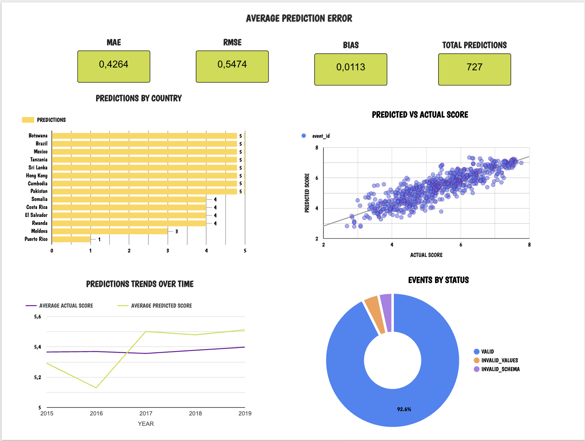

# Workshop 3 — Streaming ETL con Apache Kafka y Machine Learning

**Curso:** ETL (G01) · Ingeniería de Datos e IA · 2026-2

## 1. Descripción del proyecto

Pipeline de ETL en streaming que predice en tiempo real el **puntaje de felicidad de un país** (World Happiness Report 2015-2019).

- **Offline (batch):** se perfilan, limpian y unifican 5 CSV con esquemas distintos, y se entrena una regresión lineal.
- **Streaming:** un *producer* publica cada registro como evento en Kafka; un *consumer* valida el evento, lo guarda crudo, predice con `model.pkl` y guarda la predicción en PostgreSQL.
- **Analítica:** un dashboard consulta la base de datos (no CSV) con los KPIs de error, predicciones por país, predicho vs real y tendencia.

> El foco no es la precisión del modelo sino la integración del pipeline, su fiabilidad y su reproducibilidad.

## 2. Arquitectura

```
OFFLINE                                         STREAMING
data/raw/*.csv                                  data/processed/happiness_clean.csv
  │  EDA + limpieza + armonización                │
  ▼                                               ▼
data/processed/happiness_clean.csv   Producer ──► Kafka  topic: happiness-events
  │  features + split 70/30          (key=country)  3 particiones, RF=1
  ▼                                                │
Pipeline(StandardScaler + LinearRegression)        ▼
  │                                  Consumer (grupo happiness-ml-team)
  ▼                                    1 guarda crudo ─► raw_happiness_events
models/model.pkl ─────────────────►    2 valida contrato (VALID / INVALID_*)
                                       3 features en el orden del entrenamiento
                                       4 predice con model.pkl
                                       5 guarda ─► fact_predictions (+ dim_country, dim_date)
                                                   │
                                                   ▼
                                         vistas v_kpi_*  ──►  Dashboard (BI)
```

| Componente | Tecnología |
|---|---|
| Broker | Apache Kafka 3.9 (KRaft, un solo nodo) en Docker |
| Base de datos | PostgreSQL 16 en Docker (puerto `5433`) |
| Cliente Kafka | `confluent-kafka` |
| ML | scikit-learn `Pipeline` |
| Dashboard | Looker Studio sobre Postgres (ver `dashboards/`) |

## 3. Decisiones de limpieza de datos

Detalle y evidencia en [`notebooks/eda.ipynb`](notebooks/eda.ipynb); código en [`src/cleaning.py`](src/cleaning.py).

| Problema encontrado | Decisión | Justificación |
|---|---|---|
| Nombres de columnas distintos por año (`Economy (GDP per Capita)`, `Economy..GDP.per.Capita.`, `GDP per capita`; `Family` vs `Social support`; `Trust` vs `Perceptions of corruption`) | Diccionario explícito por año hacia un esquema común: `country, year, gdp, family, health, freedom, generosity, corruption, happiness_score` | Reproducible y auditable; no depende de heurísticas |
| `N/A` como texto en 2018 (UAE, `corruption`) hace que la columna sea `object` | Convertir a `NaN` y **imputar con la mediana de `corruption` de 2018**; bandera `corruption_imputed` | Es el único faltante; conservar el país y dejar rastro. La mediana es robusta a outliers |
| Mismo país con nombres distintos (`Hong Kong S.A.R., China`, `North Cyprus`, `Macedonia`, `Somaliland region`, `Taiwan Province of China`, `Trinidad & Tobago`) | Tabla `COUNTRY_ALIASES` con nombre canónico | Evita duplicar países en `dim_country` y rompe menos las series por país |
| Columnas que no existen en todos los años (`Region`, error estándar, intervalos, *whiskers*, `Dystopia Residual`) | Se descartan | No son comunes a los 5 años; `Dystopia Residual` es **fuga de información** del target |
| Tipos: floats con ~15 decimales en 2017, enteros/strings mezclados | Todo numérico a `float64`, redondeo a 5 decimales; `year` entero tomado del nombre del archivo | Tipos homogéneos |
| Duplicados | No existen; se verifica `(country, year)` único | — |
| Outliers (IQR) en `corruption`, `generosity`, `family` y ceros exactos | **Se conservan** | Son valores publicados por la fuente (cola legítima), no errores de captura |

Resultado: **782 filas**, 164 países, 5 años, 0 nulos. Algunos países entran o salen del ranking según el año (p. ej. Angola, Belize, Somalia): no se inventan datos.

## 4. Decisiones de ingeniería de features y modelo

Detalle en [`notebooks/model_training.ipynb`](notebooks/model_training.ipynb).

- **Features (6):** `gdp, family, health, freedom, generosity, corruption`, las mismas del contrato de eventos y presentes en los 5 años.
- **Target:** `happiness_score`. Nunca es feature; en el evento viaja como `actual_happiness_score` y solo sirve para calcular el error.
- **Excluidos:** `Dystopia Residual` (fuga), errores estándar/intervalos/whiskers (derivados del puntaje), `Region` (solo 2015-16), `year`.
- **Escalado:** `StandardScaler` dentro del `Pipeline`, aprendido solo con el conjunto de entrenamiento. No hay variables categóricas.
- **Split 70/30 por país** (`GroupShuffleSplit`): un país completo queda en train o en test (542 / 240 filas), para evitar que observaciones casi idénticas del mismo país crucen la frontera.
- **Modelos comparados:** `LinearRegression` y `RandomForestRegressor`. Se elige la regresión lineal: menor RMSE en test (0.562 vs 0.611) y el Random Forest sobreajusta (R² train 0.95 vs test 0.74).

| Métrica (test, 240 filas) | Valor |
|---|---|
| MAE | 0.432 |
| RMSE | 0.562 |
| R² | 0.784 |

`models/model.pkl` contiene el `Pipeline` completo (escalado + modelo); `models/model_metadata.json` registra features, split y la versión de scikit-learn con la que se entrenó (**1.9.1**). Cargarlo con otra versión puede fallar: usar `requirements.txt`.

## 5. Pipeline Kafka y contrato del evento

**Tópico:** `happiness-events` (3 particiones, replicación 1; lo crea el servicio `kafka-init` de Docker Compose). **Key:** `country`, así todos los eventos de un país caen en la misma partición. **Grupo:** `happiness-ml-team`.

**Evento (JSON):**

```json
{
  "event_id": "E00001", "country": "Colombia", "year": 2019,
  "gdp": 1.2, "family": 0.8, "health": 0.9, "freedom": 0.6, "generosity": 0.3, "corruption": 0.1,
  "actual_happiness_score": 6.2, "event_time": "2026-10-30T15:30:00"
}
```

**Contrato** (implementado en [`src/contract.py`](src/contract.py); 37 tests unitarios en `tests/test_contract.py`):

| Campo | Regla | Si falla |
|---|---|---|
| Mensaje | JSON legible y objeto | `INVALID_SCHEMA` |
| Campos requeridos (los 11) | presentes y no nulos | `INVALID_SCHEMA` |
| `event_id`, `country`, `event_time` | string | `INVALID_SCHEMA` |
| `year` | entero (no bool) | `INVALID_SCHEMA` |
| 6 features y `actual_happiness_score` | numéricos (no string, no bool) | `INVALID_SCHEMA` |
| `event_id`, `country` | no vacíos | `INVALID_VALUES` |
| `year` | 1990–2100 | `INVALID_VALUES` |
| features | finitas y en [0, 3] | `INVALID_VALUES` |
| `actual_happiness_score` | finito y en [0, 10] | `INVALID_VALUES` |
| `event_time` | ISO-8601 válido | `INVALID_VALUES` |
| (en el consumer) predicción no calculable o no finita | — | `PREDICTION_ERROR` |

Campos extra se ignoran. `actual_happiness_score` **nunca** entra al modelo.

**Garantías del consumer** ([`kafka/consumer.py`](kafka/consumer.py)):
1. Guarda el mensaje **crudo** antes de validar o transformar.
2. Un evento inválido queda en la tabla raw con su estado y el motivo, **no se predice y no detiene el proceso**.
3. El offset se confirma manualmente **después** de persistir el resultado (no se pierden mensajes).
4. Es **idempotente**: `UNIQUE (topic, partition, offset)` y `UNIQUE raw_event_id` en la tabla de hechos; reprocesar no duplica filas.
5. Si la base de datos se cae, reintenta el mismo mensaje.

El producer ([`kafka/producer.py`](kafka/producer.py)) envía registro a registro con un delay configurable. Tiene `--inject-errors` para corromper a propósito una fracción de eventos y demostrar las validaciones, y `--dry-run` para generar eventos sin Kafka (ejemplo en [`data/streaming/sample_events.jsonl`](data/streaming/sample_events.jsonl)).

**Pruebas del consumer** ([`tests/test_consumer.py`](tests/test_consumer.py), 8 tests de integración contra Postgres): evento válido enlazado a su raw, payload crudo idéntico al recibido, eventos inválidos guardados y omitidos, `PREDICTION_ERROR` con modelo roto o predicción no finita (no detiene el proceso) e idempotencia al reprocesar. Se omiten solos si Postgres no está levantado.

**Corrida de referencia** (782 eventos, 55 de ellos corrompidos a propósito con `--inject-errors 0.08`, más 3 mensajes basura): 727 `VALID`, 27 `INVALID_SCHEMA`, 31 `INVALID_VALUES`; las 727 predicciones llegaron a `fact_predictions` y, tras resetear los offsets y reprocesar todo, la tabla siguió en 727 filas (sin duplicados). MAE 0.4264, RMSE 0.5474.

## 6. Esquema de base de datos

Definido en [`sql/create_tables.sql`](sql/create_tables.sql); KPIs en [`sql/kpis.sql`](sql/kpis.sql).

```
raw_happiness_events (staging, no es dimensión)        dim_country            dim_date
  raw_event_id PK  event_id  kafka_topic/partition/      country_id PK          date_id PK (yyyymmdd)
  offset  kafka_key  raw_payload  received_at              country_name UNIQUE    full_date, year, quarter,
  processing_status  error_detail                                                 month, day, day_name
        │ 1                                                     │ 1                    │ 1
        │                                                       │                      │
        └──────────────► fact_predictions ◄───────────────────────┴──────────────────────┘
                         prediction_id PK, raw_event_id (FK, UNIQUE), country_id (FK), date_id (FK),
                         observation_year, actual_score, predicted_score, prediction_error (pred − real),
                         abs_prediction_error, event_time, prediction_timestamp, model_name
```

- `date_id` apunta a la fecha de `event_time` (cuándo emitió el producer); el año histórico del dato va en `observation_year`.
- `prediction_error = predicho − real` (positivo = sobreestima).
- Vistas para el BI: `v_predictions`, `v_kpi_avg_error`, `v_kpi_predictions_by_country`, `v_kpi_predicted_vs_actual`, `v_kpi_trend_by_year`, `v_kpi_trend_over_time`, `v_kpi_pipeline_quality`.

## 7. Dashboard

Dashboard en **Looker Studio**: [ver el informe](https://datastudio.google.com/reporting/3c722ea9-3083-4654-9bb7-c207c898217c) · captura en [`dashboards/dashboard.png`](dashboards/dashboard.png).



Se conecta a PostgreSQL (vistas `v_kpi_*` de [`sql/kpis.sql`](sql/kpis.sql)), **no a CSV**. Como Looker Studio no puede llegar a un Postgres en `localhost`, `scripts/sync_to_cloud.py` copia las tablas y vistas a una Postgres en la nube (Neon), y Looker se conecta ahí con SSL (certificado raíz ISRG Root X1). Cada KPI usa un tipo de gráfico distinto:

| KPI | Vista | Visual | Cómo se lee |
|---|---|---|---|
| Error promedio | `v_kpi_avg_error` | Tarjetas (MAE, RMSE, sesgo, total) | MAE = error absoluto medio (0,4264 en la corrida de referencia); sesgo = predicho − real, cercano a 0 = sin sesgo global |
| Predicciones por país | `v_kpi_predictions_by_country` | Barras horizontales (top 15) | Eventos procesados por país (máximo 5: un registro por año) |
| Predicho vs real | `v_kpi_predicted_vs_actual` | Dispersión con línea de tendencia | Cuanto más cerca de la diagonal, mejor la predicción |
| Tendencia en el tiempo | `v_kpi_trend_by_year` | Líneas | Puntaje real vs predicho promedio por año; muestra si el modelo se desvía en algún año |
| Calidad del pipeline (extra) | `v_kpi_pipeline_quality` | Dona | Proporción de eventos `VALID` frente a `INVALID_*` |

## 8. Instrucciones de ejecución

**Requisitos:** Docker con Compose v2, Python 3.10+ (probado con 3.13).

```bash
# 0. Entorno
python3 -m venv .venv && source .venv/bin/activate
pip install -r requirements.txt
cp .env.example .env            # y cambia POSTGRES_PASSWORD

# 1. Datos y modelo (ya incluidos en el repo; solo para regenerar)
python -m src.cleaning                                   # data/processed/happiness_clean.csv
jupyter nbconvert --to notebook --execute --inplace notebooks/eda.ipynb notebooks/model_training.ipynb

# 2. Infraestructura (Kafka + Postgres + creación del tópico)
docker compose up -d

# 3. Consumer (terminal 1) y producer (terminal 2)
python kafka/consumer.py
python kafka/producer.py --delay 0.2                          # flujo normal
python kafka/producer.py --delay 0 --inject-errors 0.08       # con eventos corruptos

# 4. Verificar
docker exec w3_postgres psql -U happiness -d happiness -c "SELECT * FROM v_kpi_pipeline_quality"
docker exec w3_postgres psql -U happiness -d happiness -c "SELECT * FROM v_kpi_avg_error"

# 5. Tests (los de integración requieren `docker compose up -d`)
pytest -q                                                      # 45 tests

# (Opcional) eventos de ejemplo sin Kafka
python kafka/producer.py --dry-run --limit 20 --inject-errors 0.15

# 6. Dashboard: copiar la BD a la nube (requiere CLOUD_DATABASE_URL en .env) y conectar Looker Studio a las vistas v_kpi_*
python scripts/sync_to_cloud.py --reset
```

Reiniciar desde cero: `docker compose down -v` (borra los datos de Postgres y el tópico).

## Estructura del repositorio

```
data/{raw,processed,streaming}   notebooks/{eda,model_training}.ipynb   kafka/{producer,consumer}.py
models/model.pkl                 sql/{create_tables,kpis}.sql            src/{cleaning,contract,config}.py
dashboards/                      tests/{test_contract,test_consumer}.py  scripts/sync_to_cloud.py
docker-compose.yml               requirements.txt                        .env.example
```
